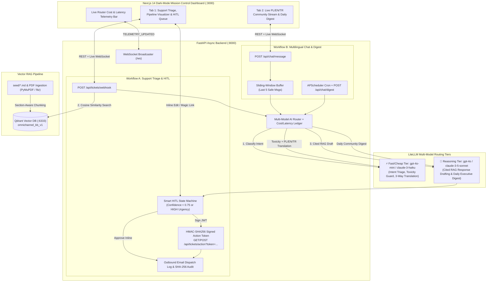
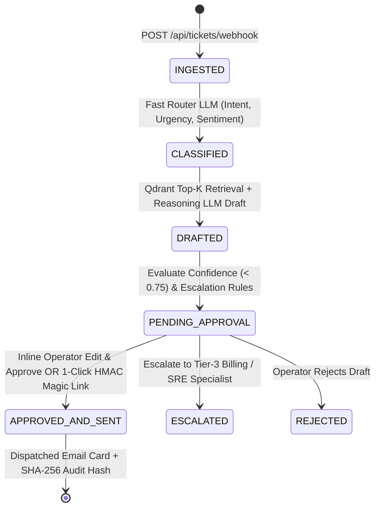

<div align="center">

# 🛡️ AegisOps AI
### Omnichannel AI Operations, Cited Vector RAG & Human-in-the-Loop Mission Control

[](https://python.org)
[](https://fastapi.tiangolo.com)
[](https://nextjs.org)
[](https://qdrant.tech)
[](https://docs.litellm.ai)
[](https://docs.pydantic.dev)
[](./LICENSE)

**AegisOps AI** (`omnichannel-ai-hub`) is an end-to-end, production-grade AI & Automation Systems platform built to demonstrate enterprise LLM orchestration patterns: **Multi-Model Cost/Latency Routing**, **Hallucination-Free Cited Vector RAG**, **Cryptographic Human-in-the-Loop (HITL) State Machines**, and **Sliding-Window Multilingual (PL/EN/TR) Stream Moderation**.

[English Documentation](#-architectural-overview) • [System Diagrams](#-system-architecture--state-machine) • [Quickstart](#-quickstart-docker--local) • [API Reference](#-rest--websocket-api-reference) • [🇹🇷 Türkçe Dokümantasyon](#-türkçe-proje-özeti-ve-kurulum-rehberi)

</div>

---

## 🚀 Architectural Overview

Modern enterprise AI systems cannot rely on a single expensive LLM or unconstrained autonomous replies. **AegisOps AI** solves four real-world production challenges in a unified dark-mode **Mission Control Dashboard**:

| Production Challenge | AegisOps AI Engineering Solution |
| :--- | :--- |
| **1. LLM Cost & Latency Bloat** | **Multi-Model Router Pattern:** High-frequency triage, toxicity moderation, and 3-way translations route to `gpt-4o-mini` / `claude-3-haiku` (~220ms), reserving `gpt-4o` / `claude-3-5-sonnet` strictly for complex cited RAG drafting and executive synthesis—saving **60%+ in token costs** and **3.8x in latency**. |
| **2. Unverified Hallucinations in Support** | **Section-Aware Qdrant Vector RAG:** Policy Markdown (`seed/*.md`) and PDFs (`PyMuPDF` / `fitz`) are indexed with explicit section anchors (`POL-REF-2026#SEC-2.1`, `TECH-KB-101`, `EDU-FAQ-04`). Every drafted reply includes verifiable inline citations and cosine similarity scores. |
| **3. Unsafe Autonomous Actions** | **Smart HITL State Machine & Cryptographic Magic Links:** Drafts with `confidence_score < 0.75`, `HIGH` urgency, or financial exceptions (`>$500` refund / chargeback threat) trigger a **`⚠️ Mandatory Human Review`** lock. Operators can edit inline or approve via **1-Click `HMAC-SHA256` Signed JWT Magic Links** (`/api/tickets/action?token=...`). |
| **4. Context-Blind Multilingual Chat** | **5-Message Sliding-Window Translation & Safety Guard:** Live community messages in **Polish (🇵🇱)**, **English (🇬🇧)**, and **Turkish (🇹🇷)** pass through an async toxicity quarantine guard and a sliding-window translator that uses the **last 5 safe messages** to resolve pronouns, technical error codes, and thread continuity. |

---

## 🏗️ System Architecture & State Machine

### 1. End-to-End Platform Architecture



### 2. Workflow A — Smart Human-in-the-Loop (HITL) State Machine



---

## 📂 Repository Structure

```text
omnichannel-ai-hub/
├── .github/workflows/ci.yml            # GitHub Actions CI (Backend smoke test + Next.js build)
├── .env.example                        # Environment & multi-model routing configuration template
├── .gitignore                          # Git ignore rules for Python, Node.js, Qdrant, and envs
├── LICENSE                             # MIT License
├── docker-compose.yml                  # Orchestrates Qdrant, FastAPI Backend, and Next.js Frontend
├── README.md                           # Architecture documentation & live demo guide
├── seed/                               # Pre-populated RAG Knowledge Base documents
│   ├── refund_policy.md                # Billing, 14-day guarantee, SLA credits & >$500 escalation rules
│   ├── technical_troubleshooting.md    # SAML 500 clock-skew, HMAC webhooks, 429 rate limits, Qdrant sync
│   └── student_university_faq.md       # .edu/.edu.pl/.edu.tr verification, 80% discount, retroactive refunds
├── backend/
│   ├── Dockerfile                      # Python 3.11-slim container definition
│   ├── requirements.txt                # FastAPI, LiteLLM, Pydantic v2, Qdrant, PyMuPDF, APScheduler, PyJWT
│   └── app/
│       ├── main.py                     # FastAPI app, CORS, lifespan seed ingestion & APScheduler startup
│       ├── config.py                   # Pydantic BaseSettings configuration loader
│       ├── models/schemas.py           # Strict Pydantic v2 schemas (Classification, RAG Draft, HITL, Chat)
│       ├── services/
│       │   ├── ai_router.py            # Multi-model LLM Router + token/latency/cost savings tracker
│       │   ├── rag_service.py          # PyMuPDF/Markdown section chunker + Qdrant vector search
│       │   ├── hitl_engine.py          # State machine + HMAC/JWT magic-link token signer & verifier
│       │   ├── chat_moderator.py       # Sliding-window (last 5 msgs) PL/EN/TR translator & toxicity filter
│       │   └── websocket_manager.py    # Real-time event broadcaster for Mission Control UI
│       └── routers/
│           ├── tickets.py              # Workflow A endpoints (/webhook, /{id}/review, /action, /demo)
│           ├── kb.py                   # Knowledge base ingestion & vector search inspection endpoints
│           └── chat.py                 # Workflow B endpoints (/message, /digest, /demo)
└── frontend/
    ├── Dockerfile                      # Node 20 Alpine container definition
    ├── package.json                    # Next.js 14, React 18, TypeScript, Tailwind CSS, Lucide Icons
    └── src/
        ├── app/page.tsx                # Dark-mode Mission Control shell & real-time WebSocket subscriber
        ├── components/
        │   ├── HeaderMetrics.tsx       # Live "Cost & Latency Saved vs. Single-Model" telemetry bar
        │   ├── SupportTriageTab.tsx    # Workflow A: Simulator, Pipeline Visualizer & HITL Queue
        │   ├── PipelineVisualizer.tsx  # Real-time 5-stage state stepper
        │   ├── HitlApprovalQueue.tsx   # Confidence slider, inline draft editor & Magic Link tester
        │   ├── OutboundEmailModal.tsx  # Dispatched email preview card with SHA-256 audit hash
        │   └── MultilingualChatTab.tsx # Workflow B: PL/EN/TR live chat, moderation flags & Daily Digest
        └── lib/
            ├── api.ts                  # Typed REST + WebSocket client
            └── types.ts                # TypeScript interfaces mirroring backend Pydantic v2 schemas
```

---

## ⚡ Quickstart (Docker & Local)

> **Zero-Key Live Demo Mode Included:** By default, `DEMO_MOCK_LLM_FALLBACK=true` is enabled so every ticket triage, Qdrant vector search, HITL escalation, and PL/EN/TR translation scenario works **immediately out of the box** without requiring paid API keys. When `OPENAI_API_KEY` or `ANTHROPIC_API_KEY` is provided in `.env`, the router seamlessly switches to live LiteLLM completions.

### Option 1: Docker Compose (Full Stack: Qdrant + FastAPI + Next.js)

```bash
git clone https://github.com/<your-username>/aegisops-ai.git
cd aegisops-ai
cp .env.example .env

docker-compose up --build
```

### Option 2: Local Development (Auto-Embedded Qdrant Engine)

If Docker is not running on your machine, `QdrantRAGService` automatically falls back to an in-memory `QdrantClient(":memory:")` instance and indexes all 15 policy sections from `seed/*.md` on startup:

```powershell
# Terminal 1 — Start FastAPI Backend (:8000)
cd backend
pip install -r requirements.txt
uvicorn app.main:app --host 0.0.0.0 --port 8000 --reload

# Terminal 2 — Start Next.js 14 Mission Control Dashboard (:3000)
cd frontend
npm install
npm run dev
```

- **Mission Control Dashboard:** `http://localhost:3000`
- **Interactive Swagger / OpenAPI Docs:** `http://localhost:8000/docs`
- **System Health & Telemetry Check:** `http://localhost:8000/api/health`

---

## 🔌 REST & WebSocket API Reference

| Method | Endpoint | Description |
| :--- | :--- | :--- |
| `GET` | `/api/health` | System health, Qdrant chunk count, active router models, and APScheduler state |
| `GET` | `/api/telemetry` | Live **Cost & Latency Saved vs. Single-Model (`gpt-4o`)** metrics and call ledger |
| `POST` | `/api/tickets/webhook` | Ingests a support ticket through Classification -> Qdrant RAG -> Draft -> HITL |
| `POST` | `/api/tickets/demo?scenario=...` | Runs preset scenarios (`duplicate_billing`, `high_value_escalation`, `enterprise_saml_500`, `academic_retroactive_refund`, `all`) |
| `POST` | `/api/tickets/{id}/review` | Inline HITL review (`APPROVE` with optional edited reply, `REJECT`, or `ESCALATE`) |
| `GET/POST` | `/api/tickets/action?token=...` | Cryptographic `HMAC-SHA256` one-click approval/rejection magic link handler |
| `POST` | `/api/tickets/threshold` | Dynamically updates the mandatory human review confidence threshold (`0.50`–`0.95`) |
| `POST` | `/api/kb/ingest` | Re-indexes `seed/*.md` and custom Markdown/PDF files (via `PyMuPDF`) into Qdrant |
| `POST` | `/api/kb/search` | Tests semantic cosine similarity search against Qdrant and returns cited snippets |
| `POST` | `/api/chat/message` | Moderates and translates a `PL`, `EN`, or `TR` message using a 5-message sliding window |
| `POST` | `/api/chat/demo` | Runs the 6-message multi-user PL/TR/EN technical conversation + toxicity quarantine test |
| `POST` | `/api/chat/digest` | Synthesizes the Executive Daily Community Digest using the Reasoning LLM |
| `WS` | `/ws` | Bi-directional WebSocket stream for live pipeline & telemetry updates |

---

## 🎬 3-Minute Live Video Demo Walkthrough

1. **0:00 – 0:30 | Telemetry Bar & One-Click Showcase:**
   - Open `http://localhost:3000` and highlight the **WebSocket Live Stream** badge and **Qdrant RAG: 15 Policy Chunks** counter.
2. **0:30 – 1:45 | Workflow A — Cited RAG & Smart HITL Escalation:**
   - Click **`1. Duplicate Billing`** -> Watch the 5-stage Pipeline Visualizer transition to `PENDING_APPROVAL` with `96%` confidence and inline citation `[POL-REF-2026#SEC-2.1]` (100% refund + \$25 goodwill credit).
   - Click **`2. >$500 Dispute (HITL!)`** -> Point out how the \$1,450 refund demand + chargeback threat yields a `64%` confidence score and triggers the **`⚠️ Mandatory Human Review`** lock (`POL-REF-2026#SEC-4.2`).
   - Edit a draft inline and click **Approve & Dispatch Email**, then test **⚡ Trigger 1-Click Magic-Link Approve Token** on another ticket and inspect the **SHA-256 Cryptographic Audit Hash** in the Outbound Email Log.
3. **1:45 – 3:00 | Workflow B — Multilingual Sliding-Window Chat & Daily Digest:**
   - Switch to **Tab 2** and click **`⚡ Run 6-Msg PL/TR/EN Demo Conversation`**.
   - Show how Elif's Turkish reply (*"Aynı sorunu dün yaşadık!"*) uses the **5-Message Sliding Window** to link back to Marek's Polish message about the Okta SAML HTTP 500 error, while `@rage_spammer_99`'s hostile message is blocked with **`QUARANTINED (Toxicity: 89%)`**.
   - Click **`🧠 Trigger Daily Digest (Reasoning LLM)`** and open **Inspect Calls** in the top bar to showcase the **60%+ Cost & Latency Savings**.

---

## 🇹🇷 Türkçe Proje Özeti ve Kurulum Rehberi

**AegisOps AI (Omnichannel AI Operations & Support Hub)**, kurumsal yapay zeka mühendisliği portfolyosu ve canlı video sunumları için geliştirilmiş uçtan uca bir üretim (production-ready) platformudur.

### Öne Çıkan Mühendislik Özellikleri
1. **Çoklu Model Yönlendirme (Router Pattern) & Maliyet Takibi:**
   - Niyet sınıflandırma, toksisite moderasyonu ve 3 dilli çeviri işlemleri hızlı/ekonomik modele (`gpt-4o-mini` / `claude-3-haiku`), kaynak gösterimli RAG yanıt yazımı ve günlük yönetici özeti ise muhakeme modeline (`gpt-4o` / `claude-3-5-sonnet`) yönlendirilir.
   - Her çağrının token, gecikme (`ms`) ve maliyet tasarrufu üst panelde canlı olarak hesaplanır.
2. **Kaynak Gösterimli Vektör RAG (Qdrant + PyMuPDF):**
   - `seed/` altındaki şirket politikaları (`POL-REF-2026`, `TECH-KB-2026`, `EDU-FAQ-2026`) bölüm bazlı parçalanarak Qdrant vektör veritabanına indekslenir.
3. **Akıllı İnsan Onay Mekanizması (HITL) & Kriptografik Magic Link:**
   - Güven skoru eşik değerin (`0.75`) altında kalan veya `>$500` iade/hukuki itiraz içeren talepler otomatik olarak **`⚠️ Mandatory Human Review`** rozetiyle işaretlenir.
   - Operatörler taslağı panel içinden düzenleyip onaylayabileceği gibi, `HMAC-SHA256` imzalı tek-tık link (`/api/tickets/action?token=...`) ile de onaylayabilir.
4. **Çok Dilli (PL / EN / TR) Kayar Pencere Çevirisi & Moderasyon:**
   - Lehçe, İngilizce ve Türkçe topluluk mesajları önce toksisite filtresinden geçer; güvenli mesajlar **son 5 mesajlık bağlam penceresi (Sliding Window)** kullanılarak zamir ve teknik terim bütünlüğü korunacak şekilde 3 dile çevrilir.

---

## 📄 License

Distributed under the **MIT License**. See [`LICENSE`](./LICENSE) for more information.
